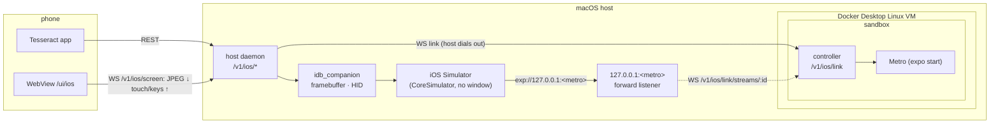

# iOS Simulator and Android emulator on a macOS host

> **Status (2026-10-19): host daemon and sandbox controller sides implemented, unverified on a real Mac.**
> `apps/controller/src/host/ios/` implements §2 (status, boot / shutdown, the idb screen session, input) and the host
> side of §3 (iOS link, reverse Metro tunnel, `openUrl`, `install` with confirmation, Expo Go provisioning).
> `apps/controller/src/services/ios-link.ts` is the sandbox side (`GET /v1/ios`, `POST /v1/ios/installs`,
> `WS /v1/ios/link`, `WS /v1/ios/link/streams/:id`) and `services/app-runs.ts` runs `expo-ios` (§3.3). Routes, types and
> env vars are in the [blueprint](00-blueprint.md) (§4.3, §5.3, §5.4, §5.7); the Android-on-Mac defaults (§5) are in
> [app-runs-and-emulator.md](app-runs-and-emulator.md) §2.1. **Not implemented yet:** `expo-ios-dev-client` (phase 2)
> and the sandbox opt-in for unisolated Android (§5); the app UI is in progress. Everything was tested on Linux with
> fake `simctl` / `idb` / `idb_companion` and a fake host link; the items in §8 must be checked on a Mac.

Goal: when the Docker host is a Mac, the phone can see and drive an **iOS Simulator**
(and the Android emulator) the same way it drives the host Android emulator: a
JPEG frame stream down, touch / keys / text up, and the sandbox can run the project's
app on it.



## 1. Constraints

- **The Simulator only runs on macOS with Xcode.** On a Mac, Docker runs containers
  in a Linux VM, so the sandbox can never run the Simulator, `simctl` or `xcodebuild`.
  A host-side component is required, exactly as for the host Android emulator
  (`tesseract-controller host serve`, §5.7 of the blueprint). The host daemon is a Bun
  binary and runs on macOS unchanged; only the `android/netns*` parts are Linux-only.
- **No KVM in the sandbox on a Mac.** Docker Desktop's VM does not reliably expose
  nested virtualization, so the Android emulator cannot run in the sandbox either.
  It keeps running on the host (§5).
- **No `netns` isolation on macOS.** `unshare` and network namespaces do not exist.
  The Simulator (and a host Android emulator) share the Mac's network stack, i.e.
  only the equivalent of today's `TESSERACT_EMULATOR_ISOLATION=none` is possible (§4).
- **No public API for live frames or input.** `xcrun simctl` can boot, install,
  launch, open URLs, take screenshots and record video to a file, but it cannot
  stream frames and cannot tap, swipe or type.

## 2. Screen and input

### 2.1 Options

| Option | Frames | Input | Window needed | Cost / risk |
|---|---|---|---|---|
| **A. `idb_companion`** (Meta, MIT) | `idb video-stream --format mjpeg\|h264` from the simulator framebuffer | HID injection: tap, swipe, text, HID keys, hardware buttons | no | private CoreSimulator / SimulatorKit APIs, can break with an Xcode release; maintenance is uneven |
| B. Own Swift helper on the same private APIs | framebuffer surface → JPEG | `SimDeviceLegacyHIDClient`-style HID, true down / move / up | no | full control (Radon IDE ships this approach), but we own the private-API breakage |
| C. ScreenCaptureKit + `CGEvent` | capture of the Simulator.app window | synthetic mouse clicks into the window | yes, on screen and focused | public APIs, but Screen Recording + Accessibility permissions, focus stealing, window chrome |
| D. WebDriverAgent (XCUITest, as Appium) | WDA MJPEG server | XCTest gestures, multi-touch | no | needs a built and signed test runner per Xcode; heavy |
| E. macOS VM (Tart / UTM / Lume) + Screen Sharing | whole VM desktop over VNC | VNC mouse and keyboard | yes | simplest and best isolated, reuses `/ui/vnc`; desktop instead of a phone-shaped view, heavy on RAM |

**Decision: A first, B if idb is not good enough, E as the documented fallback.**
A maps almost one to one onto the Android protocol, needs no Simulator window and no
macOS privacy permissions. C and D are not pursued.

### 2.2 Status, boot and shutdown

- Off unless the daemon runs with `TESSERACT_IOS=1`. `GET /v1/ios` is then `available: false` with
  `reasonCode` `disabled`; elsewhere `not_macos`, without Xcode (`xcrun simctl help` fails) `no_xcode`, without
  `idb` or `idb_companion` `no_idb`. `xcode` is the first line of `xcrun xcodebuild -version`. `isolation` is always `none`.
- Devices: `xcrun simctl list devices --json`, available iOS runtimes only (`com.apple.CoreSimulator.SimRuntime.iOS-26-0`
  → `iOS 26.0`), states `Booted|Booting|Shutdown|Shutting Down` → `booted|booting|shutdown|shutting_down`.
  `widthPt` / `heightPt` / `scale` come from `idb describe --json` while a screen session runs (else null).
- `booted` is the device this daemon booted, else the first booted one; the screen, `openUrl` and `install` use it.
- Boot: `202` with `booting`, then `simctl boot <udid>` and `simctl bootstatus <udid>` (5 min); a failure leaves the
  device `failed` with `error` until it is booted again. Shutdown: `simctl shutdown <udid>`; with
  `?signal=SIGKILL` the screen sessions and tunnel connections are dropped and every `launchd_sim` /
  `idb_companion` process whose command line contains the UDID (`ps -axo pid=,command=`) gets SIGKILL first.
- The daemon re-reads the booted device every 5 s and tells the link on a change.

### 2.3 Frame stream

One session per booted device while at least one `/v1/ios/screen` viewer is open, fanned out like the Android session:

```
idb_companion --udid <udid> --grpc-port <free loopback port>         # own process group; ready when the port accepts
IDB_COMPANION=127.0.0.1:<port> idb describe --json                     # screen_dimensions
IDB_COMPANION=127.0.0.1:<port> idb video-stream --format mjpeg --fps 30 \
  --compression-quality 0.6 --scale-factor <s>                         # JPEG frames on stdout
```

- `<s>` = min(1, maxSize / long side in pixels), `maxSize` of the first viewer (default 1280, 160..4096); 1 when
  `describe` fails.
- stdout is split on SOI / EOI; each JPEG is one binary message. `meta {deviceName, codec: "mjpeg", width, height}` is
  sent with the first frame (size read from the JPEG's SOF segment, in pixels), `size` when it changes (rotation).
- Shared per device; a late viewer gets `meta` and the last JPEG at once; a viewer with more than 512 KiB buffered
  skips frames; the session (video stream and companion) ends with its last viewer, when either process exits
  (`error` to every viewer) or when the device is shut down.

### 2.4 Input

The client protocol is the Android one (`DeviceScreenClientMessage`), so the page code is shared. `x, y` are in the
frame's pixel space and converted to points (`describe`'s `width_points` × `height_points`, swapped when the frame is
landscape; without `describe` pixels / (s × 3)). Live dragging needs idb's gRPC HID stream, which is not used yet:
the first version sends **whole gestures** through the idb CLI, one command at a time in order (at most 32 queued):

| Client message | idb | Notes |
|---|---|---|
| `touch` down … up | `idb ui tap X Y` (moved < 10 pt), `--duration <s>` when held ≥ 500 ms; else `idb ui swipe X1 Y1 X2 Y2 --duration <s>` (first → last point, 0.05–2 s) | one pointer per device: a second pointer or another viewer's touch while one is held is dropped; `cancel` and a leaving viewer drop the gesture |
| `scroll` | steps within 120 ms are summed into one `idb ui swipe` of 40 pt per step, 0.15 s | positive `vscroll` moves the finger down (content scrolls up), as on Android |
| `key` `home` / `power` | `idb ui button HOME` / `LOCK` | `back`, `app_switch`, `volume_*` are ignored |
| `key` `enter` `escape` `del` `tab` `right` `left` `down` `up` | `idb ui key 40` `41` `42` `43` `79` `80` `81` `82` (HID usages) | |
| `text` | `idb ui text <text>` (cut to 300 UTF-8 bytes) | non-ASCII may need the pasteboard (§8) |
| `rotate` | ignored | the page hides the button |

### 2.5 Page

`/ui/ios` and `/ui/android` are the same script (`src/ui/device.ts`) selected by `<body data-device="ios|android">`
(profiles in `src/ui/lib/config.ts`). The iOS page connects to `/v1/ios/screen` (fragment `ticket`, `maxSize`,
`udid`), never asks for H.264, has the bottom bar ○ home, ⏻ lock, ⌨ keyboard and posts `ios-state` /
`ios-need-ticket` (same payloads as `android-state` / `android-need-ticket`).

## 3. Running the project's app

### 3.1 The iOS link

Like the Android link: `POST /v1/ios/link` (`LinkSandbox`) stores `iosLink` in `state.json` and the daemon keeps one
WebSocket to the sandbox: `POST <sandboxUrl>/v1/auth/ticket` (bearer `token`), then
`WS <sandboxUrl>/v1/ios/link?ticket=`. Reconnect 1 s → 30 s; a close with 4000 (`IOS_LINK_REPLACED_CLOSE_CODE`)
means a newer link replaced it (no retry). The sandbox never gets `simctl`, idb's port or a host shell, only the
typed requests below. Text frames, zod-validated, discriminated on `type` (`IosLinkHostMessageSchema`,
`IosLinkSandboxMessageSchema` in `@tesseract/protocol`):

Host → sandbox:

| Message | When |
|---|---|
| `{type:"hello", hostId, version}` | on connect |
| `{type:"tunnels", tunnels: IosTunnel[]}` | on connect and after every `runs` |
| `{type:"simulator", available, booted: SimDevice \| null}` | on connect and when the booted device changes; `error` replaced by `The host simulator reported an error` |
| `{type:"progress", requestId, stage}` | `stage` ∈ `awaiting_confirmation`, `downloading`, `installing`, `installing_expo_go`, `opening` |
| `{type:"result", requestId, ok, error, bundleId?}` | the end of every request (also an immediate refusal) |
| `{type:"pong"}` | answer to `ping` |

Sandbox → host:

| Message | Host behaviour |
|---|---|
| `{type:"ping"}` | every 20 s (`LIMITS.iosLinkPingIntervalMs`) |
| `{type:"runs", runs: IosRun[]}` | the **whole** set of running `*-ios` runs (≤ 8): `{port (1024..65535), scheme (app URL scheme or null)}`. The host listens on `127.0.0.1:<port>` on the Mac for each and closes the others; a taken port is reported in `tunnels` (`Port <n> is already in use on the Mac`). `[]` closes every listener |
| `{type:"openUrl", requestId, url, expoSdkVersion?}` | refused unless `iosOpenUrlRefusal(url, runs)` is null: `exp://127.0.0.1:<announced port>[…]` or `<announced scheme>:…` (lower case, not a reserved system scheme such as `http`, `https`, `file`, `tel`, `sms`, `itms-*`, `prefs`; no userinfo; ≤ 2048 chars). For `exp://` Expo Go is installed first when missing (`simctl get_app_container <udid> host.exp.Exponent`): Expo's version index `https://api.expo.dev/v2/versions/latest`, `sdkVersions[expoSdkVersion].iosClientUrl` else `iosUrl`, https only, unpacked into `Expo Go.app`, `simctl install`. Then `simctl openurl <udid> <url>` |
| `{type:"install", requestId, artifactId}` | see §3.3 |

At most 4 requests run at once (`Too many iOS requests are running`).

**Sandbox side** (`IosLinkService`): one link at a time (a newer one closes the older with 4000); it sends `runs` on
connect and whenever the set of live `expo-ios` runs changes (from `starting` on, so the Mac listener exists before
the app is opened) and `ping` every 20 s; it keeps the host's `hello` / `simulator` / `tunnels` for `GET /v1/ios`
(`SandboxIosStatus`) and the `*-ios` availability. Requests are `IosLinkRequest`s (`ior_…`, the last 20 in
`GET /v1/ios` `requests`): `openUrl` is checked with `iosOpenUrlRefusal` before it is sent, `progress` sets `stage`,
`result` ends it `succeeded` / `failed`; requests open when the link closes, or without a `result` after 30 min, fail.
`POST /v1/ios/installs {artifactId}` (controller auth, like every route) sends `install` for an existing artifact and
answers `202` with the `running` request (503 without a link).

### 3.2 Reverse Metro tunnel

For every TCP connection the Simulator (or anything on the Mac) opens to a tunnel listener the host opens
`WS <sandboxUrl>/v1/ios/link/streams/<ios_…>?port=<port>&ticket=<fresh ticket>` (`wsPaths.iosLinkStream`,
`IosLinkStreamQuerySchema`) and pipes raw bytes both ways (binary frames; either side closing closes the other; the
TCP side is paused until the socket is open; no socket within 10 s → closed; ≤ 64 streams; pause above 1 MiB
buffered; > 4 MiB unread closes it). **Sandbox:** the upgrade needs a ticket, an `ios_…` id and a valid `port` (else
400 / 404); after it, a stream is closed with 4003 (`IOS_STREAM_REFUSED_CLOSE_CODE`) and a reason unless a link is up,
`port` is announced in `runs` and fewer than 64 streams are open. It connects to `127.0.0.1:<port>` in the sandbox,
buffering the host's bytes until then (≤ 4 MiB, also for bytes Metro does not read); Metro not listening, either side
closing, or the run leaving `runs` closes it. A WebSocket send under backpressure pauses the TCP side until drained.

The listeners are on the Mac's loopback, so anything running as the user on the Mac (and, in Tailscale userspace
mode, tailnet peers allowed to reach the Mac's loopback ports) can reach that Metro server while the run lives.

### 3.3 Run targets (sandbox)

| Target | Offered when | Command (sandbox) | Host side | Viewer |
|---|---|---|---|---|
| `expo-ios` (implemented) | framework `expo`, iOS link connected and `simulator.available` with a `booted` device | `npx expo start --go --port $P` with `CI=1`, `EXPO_NO_TELEMETRY=1`, `REACT_NATIVE_PACKAGER_HOSTNAME=127.0.0.1` | `runs` with `{port: $P, scheme: null}`; once Metro accepts TCP and the host reports a listening tunnel, `openUrl exp://127.0.0.1:$P` with `expoSdkVersion` `<major of the resolved expo package>.0.0` (Expo Go installed when missing). Ready on `ok`; a taken Mac port (`tunnels` error) or a failed open fails the run | `ios` (`{kind: "ios", udid}`) |
| `expo-ios-dev-client` (phase 2) | framework `expo` with `expo-dev-client` | `npx expo start --dev-client --port $P` | `install` of a **simulator build** (§3.4), then `openUrl <scheme>://expo-development-client/?url=…` | `ios` |

`SandboxIosStatus { linked, hostId, available, booted, tunnels, runs, requests }` is the controller's `GET /v1/ios`
(schema in `@tesseract/protocol`). `expo-ios` has a `RUN_TARGETS` entry (default port 8081, actions `reload` /
`restart` through Metro's `/message` socket in the sandbox, which reaches the app through the tunnel) and the `ios` app
viewer kind; the app opens the linked host daemon's `/ui/ios`.

### 3.4 Native builds and installs

The sandbox cannot run `xcodebuild`. Native simulator builds come from an **EAS simulator build** (`"ios": {"simulator":
true}` profile, a `.tar.gz` with an `.app`) shared as a sandbox artifact, or from `xcodebuild` on the Mac by the user. The sandbox sends one with `POST /v1/ios/installs {artifactId}` (any
artifact, e.g. one shared with `tesseract-controller share`); the host reads it with the link token.

**Installing an `.app` from the sandbox runs native code on the Mac.** `install` therefore:

1. reads `GET <sandboxUrl>/v1/artifacts/:id` (`.tar.gz`, `.tgz` or `.zip`, ≤ 2 GiB, else `result` error);
2. creates an `IosInstallRequest` (`ins_…`). Unless its `sha256` is in `state.json` `iosApprovedBundles` it is
   `pending` (`progress awaiting_confirmation`) until `POST /v1/ios/installs/:id {approve}` (session auth, i.e. the
   PIN-unlocked phone or desktop) decides; after 10 min it is `expired`. Approving remembers the hash (≤ 100);
3. downloads `/v1/artifacts/:id/download` (the hash must match the approved one), unpacks it (`tar -xzf`, `ditto -x
   -k`), finds the first `.app` within 3 levels, reads `CFBundleIdentifier` (`plutil`) and runs `simctl install`;
   the request ends `installed` with `bundleId`, or `failed`.

## 4. Security

Compared with the Linux host Android emulator in `netns` mode, a Mac host is weaker:

| Exposure | Linux host (`netns`) | macOS host |
|---|---|---|
| Guest / app reaches host loopback, LAN, tailnet | no (filtered proxy) | **yes**: JS in Expo Go (and any native app) uses the Mac's network |
| Sandbox reaches a host debug channel | adbd only, inside the netns | none: only typed link requests (`openUrl`, `install`) |
| Native code from the sandbox on the host | runs inside the emulator VM | **runs on the Mac** if an `.app` is installed (§3.4, confirmation required) |

Rules (implemented on the host daemon):

- iOS support is **off by default** (`TESSERACT_IOS=1`) and `GET /v1/ios` reports `isolation: "none"`; the app
  should show a warning like the `none` Android mode.
- idb_companion listens on loopback with a random port and is only used by the daemon.
- `openUrl` only opens `exp://127.0.0.1:<announced port>` and announced app schemes; Expo Go comes from Expo, never
  from the sandbox; sandbox `.app`s need a confirmation per bundle hash.
- The reverse tunnel only forwards ports the sandbox announced, and only while the link is up; the sandbox side
  must restrict them to running `*-ios` runs.
- For untrusted or confidential projects, use option E (a macOS VM) as the isolated setup: Simulator and Xcode
  inside the VM, viewed through `/ui/vnc`.

## 5. Android emulator on a Mac host

Done in the host daemon: Android Studio's `~/Library/Android/sdk` (and the desktop app's
`~/Library/Application Support/Tesseract/android-sdk`) in the SDK search, Homebrew's
`/opt/homebrew/share/scrcpy/scrcpy-server` in the scrcpy search, Homebrew prefixes on the tool `PATH`,
`TESSERACT_EMULATOR_ISOLATION` defaulting to `none` and `TESSERACT_EMULATOR_GPU` to `host` on macOS. Apple Silicon
needs `arm64-v8a` system images. Still open (sandbox side): `*-android` run targets require `isolated: true`; on macOS
that should become an explicit opt-in (`TESSERACT_EMULATOR_ALLOW_UNISOLATED=1`), shown as a warning in the app.

## 6. Types and API

Authoritative names are in `@tesseract/protocol` (`schemas/ios.ts`) and blueprint §5.4 / §5.7: `SIM_STATES`,
`SimDevice`, `HostIosStatus`, `BootSimulator`, `IosLinkInfo`, `IosTunnel`, `IosInstallRequest`, `DecideIosInstall`,
`IosScreenQuery`, `IosRun`, `IosLinkHostMessage`, `IosLinkSandboxMessage`, `IosLinkStreamQuery`, `SandboxIosStatus`,
`IosLinkRequest`, `InstallOnSimulator`, `IOS_LINK_REQUEST_STATES` / `IOS_LINK_REQUEST_TYPES`, the `expo-ios` run target
and the `ios` `AppViewer`,
`iosOpenUrlRefusal`, `DeviceScreenClientMessage` / `DeviceScreenServerMessage`, `STOP_SIGNALS` / `StopSignalQuerySchema`;
routes `restPaths.ios|iosSimulator|iosLink|iosInstalls|iosInstall`, `wsPaths.iosLink|iosLinkStream|iosScreen`,
`uiPaths.ios`. Client (`TesseractClient`, the host session client): `hostIosStatus`, `bootSimulator`,
`shutdownSimulator({ signal? })`, `linkIosSandbox`, `unlinkIosSandbox`, `iosInstalls`, `decideIosInstall`,
`iosScreenPageUrl`, `iosScreenSocketUrl`, and `getIosStatus` / `installOnSimulator(artifactId)` for the sandbox side.

## 7. Plan

1. **Spike on a Mac** (½–1 day): the items of §8.
2. ~~Host daemon `host/ios/` (status, boot / shutdown, screen session) + `/ui/ios` (shared device page).~~ Done.
   Mobile / desktop: a "Simulator" entry next to the Android emulator.
3. ~~iOS link + reverse Metro tunnel, controller side and the `expo-ios` run target.~~ Done (unverified on a Mac).
4. ~~Android on macOS (§5), host daemon part.~~ Done; the sandbox opt-in remains.
5. Phase 2: `expo-ios-dev-client` with EAS simulator builds (install confirmation is done on the host).
6. Live touch through idb's gRPC HID stream (or option B) instead of whole gestures.

If the spike shows idb is unreliable, switch to option B (own helper) for frames and input, or ship option E only.

## 8. Unverified on a real Mac

Written against idb / Xcode documentation and tested with fakes only:

- `idb_companion --udid <udid> --grpc-port <port>` flags and readiness (the daemon waits until the port accepts).
- The idb CLI reaching that companion through `IDB_COMPANION=127.0.0.1:<port>` without `--udid`.
- `idb video-stream --format mjpeg --fps --compression-quality --scale-factor` writing MJPEG to **stdout**, frame
  latency, and whether `--scale-factor` sizes the frames as expected.
- `idb describe --json` field names (`screen_dimensions.width|height|density|width_points|height_points`) and that
  `idb ui tap/swipe` take **points**; the coordinate space after rotation.
- `idb ui swipe … --duration`, `ui tap --duration`, `ui key <HID usage>`, `ui button HOME|LOCK` argument forms;
  `ui text` with non-ASCII (may need `simctl pbcopy` + Cmd-V).
- `xcrun simctl help` failing without Xcode (Command Line Tools only), `simctl bootstatus` after `simctl boot`.
- `launchd_sim` command lines containing the device UDID (SIGKILL shutdown).
- Expo's version index shape (`data.sdkVersions[…].iosClientUrl`, `data.iosUrl`) and the Expo Go archive holding the
  bundle's contents at its root; `plutil -extract CFBundleIdentifier raw`; `ditto -x -k` for `.zip` builds.
- Behaviour across an Xcode update (idb uses private CoreSimulator APIs).
- End to end through Docker Desktop: Expo Go loading `exp://127.0.0.1:<port>` through the Mac listener and the
  stream WebSocket (manifest, bundle, Metro's `/message` and HMR sockets over the raw TCP tunnel), and Metro's
  manifest using `127.0.0.1:<port>` with `REACT_NATIVE_PACKAGER_HOSTNAME=127.0.0.1`.
